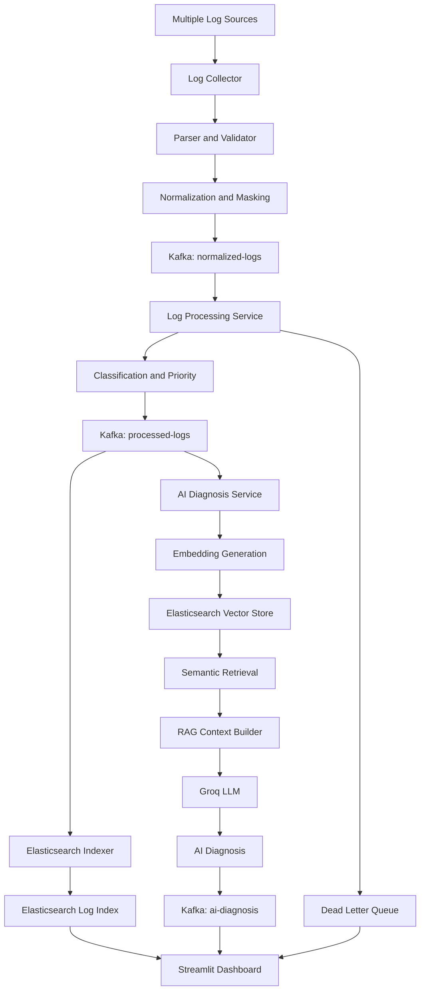

# Universal Log Processing Framework with AI Analysis

### Intelligent Log Processing | Real-Time Streaming | Semantic Search | AI-Powered Investigation

An end-to-end, event-driven log processing and analysis platform designed to transform raw application logs into structured, searchable, and actionable intelligence using **Python, Apache Kafka, Elasticsearch, Retrieval-Augmented Generation (RAG), and Large Language Models (LLMs).**

The system combines scalable log processing with AI-powered diagnosis to help developers and system administrators understand application failures, investigate incidents, and identify potential root causes.

---

## Overview

Modern applications generate massive volumes of logs across different services, systems, and formats. Manually analyzing these logs makes troubleshooting slow, especially when errors are distributed across multiple services.

The Universal Log Processing Framework addresses this challenge through a unified architecture that:

- Collects logs from multiple sources and formats.
- Parses, validates, and normalizes incoming records.
- Masks sensitive information before downstream processing.
- Processes log events through Apache Kafka.
- Classifies events according to severity and priority.
- Stores searchable logs in Elasticsearch.
- Uses semantic vector search to retrieve relevant historical events.
- Applies RAG and LLMs to generate contextual AI diagnoses.
- Provides an interactive dashboard for log exploration and investigation.

**The objective is not just to store logs, but to make them understandable and useful for troubleshooting.**

## Key Features

| Feature | Description |
|---|---|
| Multi-format collection | JSON, XML, CSV, Syslog, CEF and LEEF |
| Log normalization | Standardized structure across different sources |
| Sensitive data masking | Masks passwords, tokens and email addresses |
| Real-time streaming | Kafka-based event processing |
| Severity classification | CRITICAL, ERROR, WARNING and INFO |
| Priority assignment | P1, P2, P3 and P4 |
| Elasticsearch indexing | Centralized log storage and search |
| Semantic search | Similarity-based historical log retrieval |
| AI diagnosis | Contextual error analysis using LLMs |
| RAG architecture | Combines retrieved log evidence with LLM generation |
| Dead Letter Queue | Handles failed log-processing events |
| Incident management | Dedicated incident investigation interface |
| Interactive dashboard | Streamlit-based monitoring and analysis |

## System Architecture



## Technology Stack

| Category | Technology |
|---|---|
| Programming Language | Python |
| Event Streaming | Apache Kafka 4.3.1 |
| Search and Storage | Elasticsearch 8.17.4 |
| Vector Search | Elasticsearch Dense Vectors |
| Embedding Model | Sentence Transformers |
| Pre-trained Model | all-MiniLM-L6-v2 |
| AI / LLM | Groq API |
| AI Architecture | Retrieval-Augmented Generation (RAG) |
| Frontend | Streamlit |
| Containerization | Docker |
| Local State | SQLite |
| Version Control | Git and GitHub |

## Architecture and Processing Pipeline

### 1. Log Collection

The collection layer accepts logs from different applications and sources.

Supported formats:

- JSON
- XML
- CSV
- Syslog
- Common Event Format (CEF)
- Log Event Extended Format (LEEF)

### 2. Parsing, Validation and Normalization

The parser extracts relevant information from incoming records and converts them into a consistent structure.

Validation ensures that records contain the required information before entering the processing pipeline.

### 3. Sensitive Data Masking

Sensitive information is masked to reduce the risk of exposing confidential data during processing and analysis.

Examples include:

- Passwords
- Authentication tokens
- Email addresses

### 4. Kafka-Based Streaming

Apache Kafka acts as the messaging backbone of the framework.

The main topics include:

| Kafka Topic | Purpose |
|---|---|
| `normalized-logs` | Receives normalized log events |
| `processed-logs` | Contains classified and processed events |
| `dead-letter-logs` | Stores failed log-processing events |
| `ai-diagnosis` | Publishes AI-generated diagnoses |
| `ai-diagnosis-dlq` | Handles failed AI diagnosis events |

### 5. Classification and Prioritization

The processing service classifies log events and assigns priorities.

| Severity | Classification | Priority |
|---|---|---|
| CRITICAL | SYSTEM_FAILURE | P1 |
| ERROR | APPLICATION_ERROR | P2 |
| WARNING | POTENTIAL_ISSUE | P3 |
| INFO | NORMAL_OPERATION | P4 |

This helps identify the events requiring immediate attention.

### 6. Elasticsearch Integration

Processed events are indexed in Elasticsearch.

The search layer enables efficient retrieval and filtering of logs based on available fields and search criteria.

### 7. AI-Powered Log Diagnosis

The AI diagnosis service analyzes relevant ERROR and CRITICAL events.

It uses historical log information and semantic retrieval to provide additional context for diagnosing failures.

### 8. Dead Letter Queue

When a log cannot be processed successfully, it can be routed to the appropriate Dead Letter Queue.

This helps isolate failures without silently losing problematic events and supports subsequent investigation.

## AI Analysis and RAG Workflow

One of the most important components of this project is its AI-powered diagnostic pipeline.

Instead of asking an LLM to analyze an error without context, the framework retrieves relevant historical log information and provides it to the model.

**The workflow:**

1. **Embedding Generation:** Sentence Transformers converts log text into numerical vector representations.
2. **Vector Storage:** Embeddings are stored in an Elasticsearch vector index.
3. **Semantic Search:** Relevant historical logs are retrieved based on vector similarity.
4. **Context Building:** Retrieved information is organized into useful diagnostic context.
5. **LLM Analysis:** The context is provided to a Groq-hosted language model.
6. **Diagnosis Publishing:** The generated diagnosis is published through the `ai-diagnosis` Kafka topic.

This architecture combines information retrieval with language-model reasoning to generate more context-aware diagnostic explanations.

## Interactive Dashboard

The Streamlit application provides five main modules.

| Module | Functionality |
|---|---|
| Log Explorer | Search, filter and inspect processed logs |
| AI Assistant | Interact with the AI-powered diagnostic assistant |
| AI Investigations | Investigate related events and service-level issues |
| Incidents | Review and investigate incidents |
| Dead Letter Queue | Inspect failed log-processing events |

## Project Structure

```text
Universal-Log-Processing-Framework/
│
├── frontend/
│   ├── app.py
│   ├── config.py
│   ├── data_service.py
│   ├── ai_service.py
│   ├── dlq_service.py
│   ├── incidents_service.py
│   ├── investigations_service.py
│   │
│   └── pages/
│       ├── 1_Log_Explorer.py
│       ├── 2_AI_Assistant.py
│       ├── 3_AI_Investigations.py
│       ├── 4_Incidents.py
│       └── 5_Dead_Letter_Queue.py
│
├── log_collector.py
├── log_parser.py
├── kafka_publisher.py
├── log_processing_service.py
├── kafka_consumer.py
│
├── elasticsearch_indexer.py
├── elasticsearch_search.py
├── elasticsearch_vector_store.py
│
├── log_embedding_generator.py
├── log_retriever.py
├── rag_context_builder.py
├── rag_pipeline.py
├── llm_diagnosis.py
├── ai_diagnosis_service.py
├── migrate_logs_to_vector_store.py
│
├── docker-compose.kafka.yml
├── docker-compose.elasticsearch.yml
├── requirements.txt
├── .gitignore
│
└── test_*.py
```

## Installation and Setup

### Prerequisites

- Python 3.10 or compatible version
- Docker Desktop
- Git
- Groq API key

### 1. Clone the repository

```bash
git clone https://github.com/GAURAVSri123/Universal-Log-Processing-Framework.git

cd Universal-Log-Processing-Framework
```

### 2. Create a virtual environment

```powershell
python -m venv .venv

.venv\Scripts\Activate.ps1
```

### 3. Install dependencies

```bash
pip install -r requirements.txt
```

### 4. Configure environment variables

Create a `.env` file in the project root.

```env
GROQ_API_KEY=your_groq_api_key
GROQ_MODEL=your_supported_groq_model
```

Replace the placeholder values with your actual credentials and supported model configuration.

**Security:** Never commit or publish your `.env` file or API credentials.

### 5. Start Apache Kafka

```bash
docker compose -f docker-compose.kafka.yml up -d
```

### 6. Start Elasticsearch

```bash
docker compose -f docker-compose.elasticsearch.yml up -d
```

### 7. Start the processing services

Run the required backend services in separate terminal windows, in pipeline order:

```bash
python log_collector.py
```

```bash
python log_processing_service.py
```

```bash
python elasticsearch_indexer.py
```

```bash
python ai_diagnosis_service.py
```

Ensure the required Kafka topics, Elasticsearch connection, and environment configuration are available before starting the services.

### 8. Launch the dashboard

```bash
streamlit run frontend/app.py
```

Open the local URL displayed in your terminal to access the application.

## Testing

The project includes tests covering different parts of the processing architecture.

Current test modules include:

- Collector startup and shutdown handling
- Kafka log collection
- Kafka publishing failure handling
- Kafka failure scenarios
- Parser error handling
- Groq API integration

Example:

```bash
python test_parser_errors.py
```

Individual test scripts can be executed to verify their respective components.

## Future Scope

Potential future improvements include:

- Machine-learning-based anomaly detection.
- Advanced distributed incident correlation.
- Automated root-cause analysis.
- Additional log source integrations.
- Role-based access control.
- Advanced alerting and notification mechanisms.
- Cloud-based deployment and horizontal scaling.

## Author

**Gaurav**

Computer Science Student | Machine Learning and AI Enthusiast

GitHub: [@GAURAVSri123](https://github.com/GAURAVSri123)

**Project Repository:**  
[Universal Log Processing Framework with AI Analysis](https://github.com/GAURAVSri123/Universal-Log-Processing-Framework)

---

*Built to transform raw logs into meaningful insights through distributed processing, semantic retrieval, and AI-powered analysis.*
