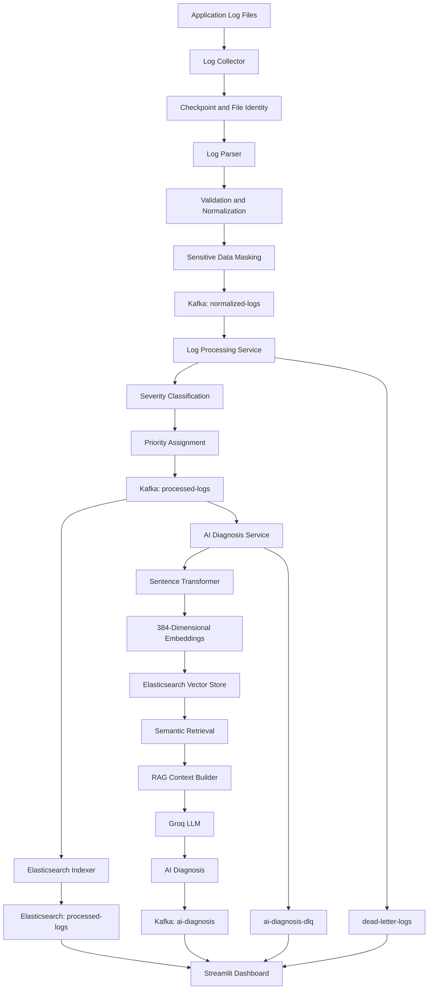

# Universal Log Processing Framework with AI Analysis

<p align="center">

**An Intelligent, Event-Driven Log Processing and AI Investigation Platform**

Transforming raw application logs into structured, searchable, and actionable insights.

</p>

---

## Overview

The **Universal Log Processing Framework with AI Analysis** is an end-to-end log processing and investigation platform built using Python, Apache Kafka, Elasticsearch, Sentence Transformers, Retrieval-Augmented Generation (RAG), and Large Language Models (LLMs).

Modern applications generate large volumes of logs across different services and formats. Manually examining these records makes it difficult to identify failures, understand recurring errors, and investigate application problems.

This project addresses that challenge through a unified pipeline that collects application logs, parses and normalizes records, masks sensitive information, processes events through Kafka, classifies their severity, and indexes them in Elasticsearch.

It also integrates semantic vector search and an AI-powered diagnosis pipeline. Relevant historical log records are retrieved and supplied as context to an LLM, helping generate explanations, possible causes, verification steps, and recommended actions.

A Streamlit dashboard provides a centralized interface for monitoring, searching, and investigating processed logs.

**The primary objective is to transform raw log data into meaningful information that supports application troubleshooting and operational analysis.**

---

## Key Features

| Feature | Implementation |
|---|---|
| Multi-format log parsing | JSON, XML, CSV, Syslog, CEF and LEEF |
| Log normalization | Converts supported input records into a canonical structure |
| Sensitive information masking | Masks configured sensitive fields, email addresses and phone-like values |
| File-based log collection | Reads application log files incrementally |
| Checkpoint management | Stores file offsets and identifies files during rotation or renaming |
| Event streaming | Apache Kafka |
| Severity classification | CRITICAL, ERROR, WARNING, INFO and DEBUG |
| Priority assignment | P1, P2, P3, P4 and P5 |
| Failed-event handling | Kafka Dead Letter Queues |
| Log storage and search | Elasticsearch |
| Semantic embeddings | Sentence Transformers |
| Vector search | Elasticsearch dense-vector similarity search |
| AI diagnosis | Groq-hosted LLM |
| RAG architecture | Combines historical log retrieval with LLM analysis |
| Interactive dashboard | Streamlit and Plotly |
| Local infrastructure | Docker Compose |

---

## System Architecture



---

## Technology Stack

| Category | Technology |
|---|---|
| Programming Language | Python |
| Event Streaming | Apache Kafka 4.3.1 |
| Kafka Client | kafka-python and confluent-kafka |
| Search and Storage | Elasticsearch 8.17.4 |
| Vector Database | Elasticsearch Dense Vectors |
| Embedding Framework | Sentence Transformers |
| Embedding Model | all-MiniLM-L6-v2 |
| Embedding Dimensions | 384 |
| AI / LLM Provider | Groq API |
| AI Architecture | Retrieval-Augmented Generation |
| Dashboard | Streamlit |
| Data Analysis and Visualization | Pandas and Plotly |
| Local Database | SQLite for local processing state |
| Containerization | Docker Compose |
| Version Control | Git and GitHub |

---

## Architecture and Processing Pipeline

### 1. Log Collection

The collection layer reads application log files from the project's `logs/` directory.

The collector:

- Discovers supported log files.
- Reads new records incrementally.
- Publishes parsed events into Kafka.
- Maintains checkpoints to track previously processed file positions.
- Uses file identity information to help recognize renamed or rotated files.
- Recovers saved offsets where the physical file identity matches.

Checkpoint information is stored in the `checkpoints/` directory.

This approach helps avoid repeatedly reading the entire file when the collector restarts.

### 2. Parsing and Normalization

Different applications produce logs in different formats. The parser converts supported records into a consistent structure.

Supported formats include:

- JSON
- XML
- CSV
- Syslog
- Common Event Format (CEF)
- Log Event Extended Format (LEEF)

The canonical log structure contains fields such as:

| Field | Purpose |
|---|---|
| `timestamp` | Time associated with the log event |
| `level` | Log severity |
| `service` | Application or service name |
| `message` | Main log message |
| `attributes` | Additional structured information |
| `raw` | Masked representation of the original record |
| `metadata` | Source and ingestion information |

The parser also validates required fields before an event enters the downstream processing pipeline.

### 3. Sensitive Data Masking

Logs can contain confidential information, including authentication credentials and personally identifiable information.

The framework includes masking logic to reduce the risk of exposing sensitive values.

Configured sensitive fields include:

- Passwords
- Secrets
- Access and refresh tokens
- API keys
- Authorization values
- Cookies
- Credit-card and card-number fields
- Social Security Number fields

The parser also includes masking for email addresses and phone-number-like values.

**Note:** This is a practical masking implementation, not a guarantee that every possible form of sensitive information will be detected. Production deployments should add organization-specific detection rules and security testing.

### 4. Kafka-Based Event Streaming

Apache Kafka provides the messaging backbone of the architecture.

It separates log collection from downstream processing, indexing, and AI analysis.

The main Kafka topics are:

| Topic | Purpose |
|---|---|
| `normalized-logs` | Receives parsed and normalized log events |
| `processed-logs` | Contains validated, classified and prioritized events |
| `dead-letter-logs` | Stores events that fail log processing |
| `ai-diagnosis` | Receives AI-generated diagnosis events |
| `ai-diagnosis-dlq` | Stores events that fail AI diagnosis processing |

The services communicate through Kafka rather than relying on direct communication between every component.

### 5. Log Classification and Prioritization

The Log Processing Service consumes events from `normalized-logs`.

It validates each event, identifies its severity, assigns a classification and priority, and publishes the processed event to `processed-logs`.

The implemented classification rules are:

| Severity | Classification | Priority |
|---|---|---|
| CRITICAL | SYSTEM_FAILURE | P1 |
| ERROR | APPLICATION_ERROR | P2 |
| WARNING | POTENTIAL_ISSUE | P3 |
| INFO | NORMAL_OPERATION | P4 |
| DEBUG | DIAGNOSTIC_INFORMATION | P5 |

Priority levels help distinguish critical failures from normal operational and diagnostic information.

### 6. Elasticsearch Indexing and Search

The Elasticsearch Indexer consumes events from `processed-logs` and stores them in the `processed-logs` index.

Elasticsearch provides:

- Centralized log storage.
- Search by severity.
- Search by service.
- Search by priority.
- Keyword-based message search.
- Aggregations for dashboard metrics.
- Retrieval of recent processed events.

The dashboard uses Elasticsearch to display log statistics and provide searchable records.

### 7. Semantic Embedding Generation

Traditional keyword searches may not identify logs that describe similar problems using different words.

To improve historical log retrieval, the framework uses Sentence Transformers.

The selected model is:

`sentence-transformers/all-MiniLM-L6-v2`

The embedding generator converts log information into a numerical vector containing **384 dimensions**.

The embedding text incorporates available fields such as:

- Service
- Severity
- Classification
- Priority
- Message

These embeddings allow the system to compare log events based on semantic similarity.

### 8. Elasticsearch Vector Search

Generated embeddings are stored in the Elasticsearch vector index:

`log-knowledge-base`

The index uses dense vectors with cosine similarity.

When a new error requires investigation, the system generates an embedding for the query and searches for semantically similar historical log records.

The retrieval pipeline is configured to return a limited number of relevant records (top-k), rather than sending the entire log history to the LLM.

### 9. AI-Powered Diagnosis with RAG

The project uses Retrieval-Augmented Generation (RAG) to provide historical log context to an LLM.

The diagnosis service:

1. Consumes events from `processed-logs`.
2. Selects ERROR and CRITICAL events for AI diagnosis.
3. Generates a query from the current log information.
4. Retrieves relevant historical log records through semantic search.
5. Builds diagnostic context using the retrieved evidence.
6. Sends the context to a Groq-hosted language model.
7. Produces a structured diagnosis.
8. Publishes the result to `ai-diagnosis`.

The AI diagnosis includes:

- Problem summary
- Severity assessment
- Possible causes
- Supporting evidence
- Verification steps
- Confirmed causes, when supported by evidence
- Recommended actions
- Confidence level
- Diagnostic limitations

The prompt instructs the model not to present possible causes as confirmed root causes without direct supporting evidence.

**Important:** AI-generated diagnoses are investigative assistance. They should be verified against application behavior, infrastructure metrics and other operational evidence.

### 10. Dead Letter Queue Handling

The framework includes separate failure-handling paths for log processing and AI diagnosis.

- `dead-letter-logs` stores events that fail the log-processing stage.
- `ai-diagnosis-dlq` stores events that fail the AI diagnosis stage.

Failure records include relevant error details and source Kafka information where available.

The services use controlled processing and publication logic to avoid silently discarding problematic events.

The dashboard provides a read-only view of recent dead-letter messages. It does not currently provide message replay, retry, or deletion controls.

---

## Interactive Dashboard

The Streamlit application provides six functional sections.

| Dashboard Section | Description |
|---|---|
| **Overview Dashboard** | Displays processed-log metrics, severity and priority distributions, daily activity trends and knowledge-base statistics. |
| **Log Explorer** | Searches, filters and inspects processed logs using Elasticsearch. |
| **AI Assistant** | Provides a conversational interface for general log-related questions and diagnostic assistance. |
| **AI Investigations** | Displays recent AI diagnosis events and helps examine historical investigation results. |
| **Incidents** | Presents a read-only incident-style view derived from AI diagnosis events. |
| **Dead Letter Queue** | Displays recent failed messages from the two DLQ Kafka topics. |

### Important Dashboard Design Details

**AI Assistant and AI Investigations are separate features.**

- AI Assistant provides a conversational interface and determines whether a question requires historical log retrieval.
- AI Investigations focuses on retrieving and displaying existing AI diagnosis events.

**Incidents is a read-only view.**

Each displayed incident represents an AI-diagnosed log event. The current implementation does not maintain a complete incident lifecycle with open, acknowledged, assigned and resolved states.

**Dead Letter Queue is also read-only.**

It displays available failed messages for inspection. It does not currently replay, retry or delete Kafka messages.

---

## Project Structure

The following is a view of the principal project files and directories:

```text
Universal-Log-Processing-Framework/
│
├── frontend/
│   ├── app.py
│   ├── config.py
│   ├── data_service.py
│   ├── ai_service.py
│   ├── dlq_service.py
│   ├── incidents_service.py
│   ├── investigations_service.py
│   └── pages/
│       └── 1_Log_Explorer.py
│
├── logs/
├── checkpoints/
│
├── log_collector.py
├── log_parser.py
├── kafka_publisher.py
├── kafka_consumer.py
├── log_processing_service.py
│
├── elasticsearch_indexer.py
├── elasticsearch_search.py
├── elasticsearch_vector_store.py
│
├── log_embedding_generator.py
├── log_retriever.py
├── rag_context_builder.py
├── rag_pipeline.py
├── llm_diagnosis.py
├── ai_diagnosis_service.py
├── migrate_logs_to_vector_store.py
│
├── docker-compose.kafka.yml
├── docker-compose.elasticsearch.yml
├── requirements.txt
├── .gitignore
│
└── test_*.py
```

This tree highlights the main application components; it is not intended to enumerate every repository file or every dashboard page.

---

## Installation and Setup

### Prerequisites

Install the following before running the project:

- Python compatible with the pinned project dependencies.
- Docker Desktop with Docker Compose.
- Git.
- A Groq API key.
- Sufficient memory and disk space for Elasticsearch and the embedding model.

### 1. Clone the Repository

```powershell
git clone https://github.com/GAURAVSri123/Universal-Log-Processing-Framework.git

cd Universal-Log-Processing-Framework
```

### 2. Create a Virtual Environment

```powershell
python -m venv .venv

.venv\Scripts\Activate.ps1
```

If PowerShell blocks virtual-environment activation, use an appropriate execution policy for your local environment or activate the environment through another supported terminal.

### 3. Install Dependencies

```powershell
python -m pip install --upgrade pip

pip install -r requirements.txt
```

### 4. Configure Environment Variables

Create a `.env` file in the project root.

```env
GROQ_API_KEY=your_groq_api_key
GROQ_MODEL=openai/gpt-oss-120b
```

The configured model is the default in the current LLM implementation. Change it only to a model supported by your Groq account.

**Security:** Never commit `.env` files, API keys or other credentials to GitHub.

### 5. Start Apache Kafka

Run:

```powershell
docker compose -f docker-compose.kafka.yml up -d
```

The Kafka container is configured to expose port `9092`.

### 6. Start Elasticsearch

Run:

```powershell
docker compose -f docker-compose.elasticsearch.yml up -d
```

Elasticsearch is configured at:

```text
http://localhost:9200
```

The supplied local Docker configuration uses a single-node setup with Elasticsearch security disabled. It is intended for local development, not direct production deployment.

### 7. Start the Log Processing Pipeline

Open separate PowerShell terminals, activate the virtual environment in each terminal, and run the services.

**Terminal 1 — Log Collector**

```powershell
python log_collector.py
```

**Terminal 2 — Log Processing Service**

```powershell
python log_processing_service.py
```

**Terminal 3 — Elasticsearch Indexer**

```powershell
python elasticsearch_indexer.py
```

**Terminal 4 — AI Diagnosis Service**

```powershell
python ai_diagnosis_service.py
```

The services depend on the availability of Kafka, Elasticsearch and the required configuration.

### 8. Launch the Dashboard

Open another terminal and run:

```powershell
streamlit run frontend/app.py
```

Streamlit will display a local application URL in the terminal. Open that URL in your browser.

---

## Testing and Verification

The repository contains individual test scripts for checking different parts of the application.

For example, the parser error-handling test can be executed with:

```powershell
python test_parser_errors.py
```

The parser test exercises cases including:

- Unknown log sources.
- Malformed JSON.
- Missing required fields.
- Invalid severity values.
- Valid JSON records.

Other project test scripts should be executed individually according to their respective component and dependencies.

For an end-to-end verification, check that:

1. Kafka and Elasticsearch containers are running.
2. The collector discovers the configured log files.
3. Normalized events appear in `normalized-logs`.
4. Processed events appear in `processed-logs`.
5. Elasticsearch indexes processed events.
6. Embeddings are available in `log-knowledge-base`.
7. Eligible ERROR and CRITICAL events receive AI diagnosis.
8. Diagnosis events appear in `ai-diagnosis`.
9. Failed events are routed to the appropriate DLQ.
10. The dashboard can retrieve and display the available information.

---

## Configuration and Operational Notes

- Kafka and Elasticsearch connection addresses are configured in the relevant project modules.
- The dashboard's Elasticsearch configuration is defined in `frontend/config.py`.
- The collector reads from the project's `logs/` directory.
- Collector checkpoint files are stored in `checkpoints/`.
- The AI diagnosis service uses a maximum of three processing attempts for an AI event.
- The diagnosis service processes ERROR and CRITICAL events.
- The RAG pipeline retrieves up to three relevant historical logs by default.
- The local Elasticsearch Docker configuration uses a persistent Docker volume for Elasticsearch data.

For production use, connection settings, credentials, resource limits and security policies should be moved into a centrally managed configuration system.

---

## Current Limitations

The current implementation is designed as a local, modular log-processing and AI-analysis platform.

The following capabilities are not represented as completed features:

- Full incident lifecycle management.
- Automatic incident assignment and resolution.
- DLQ replay, retry and deletion from the dashboard.
- Production-grade authentication and role-based access control.
- Distributed high-availability deployment.
- Fully automated root-cause confirmation.
- Comprehensive detection of every possible type of sensitive information.

These are potential areas for further development.

---

## Future Enhancements

The following improvements can extend the current framework:

### 1. Advanced DLQ Resource Management

Introduce configurable DLQ retention periods, storage quotas, size limits and monitoring alerts.

These controls are **planned enhancements** and are not currently implemented. They will be considered for implementation after the current project documentation is submitted.

### 2. Automated DLQ Recovery

Add controlled replay and retry workflows, with safeguards against duplicate processing.

### 3. Incident Lifecycle Management

Introduce incident creation, assignment, acknowledgement, status transitions and resolution tracking.

### 4. Advanced Anomaly Detection

Explore machine-learning approaches to detect unusual log patterns and unexpected service behavior.

### 5. Alerting and Notifications

Integrate configurable alerts for critical failures, recurring errors and unusual log activity.

### 6. Security and Access Control

Add authentication, role-based access control, secure secret management and production-grade transport security.

### 7. Scalability and Deployment

Explore distributed deployment, Kafka partition planning, service monitoring and cloud infrastructure.

---

## Author

**Gaurav**

Computer Science Student | Interested in Machine Learning, AI and Software Engineering

GitHub: [@GAURAVSri123](https://github.com/GAURAVSri123)

Project Repository:

[Universal Log Processing Framework with AI Analysis](https://github.com/GAURAVSri123/Universal-Log-Processing-Framework)

---

## Project Objective

The Universal Log Processing Framework demonstrates how distributed event streaming, structured log processing, centralized search, semantic retrieval and Large Language Models can be integrated into a single application.

By combining these technologies, the project aims to make log analysis more organized, searchable and useful for troubleshooting complex application behavior.

**Built to transform raw application logs into meaningful operational insights through distributed processing, semantic search and AI-powered investigation.**
